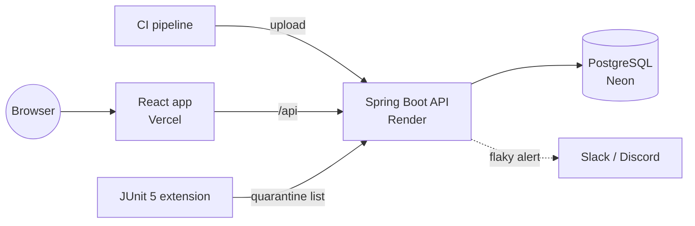

<div align="center">


# FlakyHunter

**Find flaky tests in your CI. Tell them apart from real bugs. Quarantine them.**

[](https://github.com/Devisri4/flakyhunter/actions/workflows/backend.yml)
[](https://github.com/Devisri4/flakyhunter/actions/workflows/frontend.yml)
[](https://github.com/Devisri4/flakyhunter/actions/workflows/e2e.yml)


**[Live demo](https://flakyhunter.vercel.app/p/demo)** · **[API docs](https://flakyhunter.vercel.app/api/docs)** · **[Plan](docs/PLAN.md)**

</div>

---

## Why

A flaky test passes and fails without any code change. It blocks builds, wastes time and teaches teams to ignore
red CI. FlakyHunter reads the test reports your CI already produces and tells you **which tests are flaky, which
are really broken, and why**.

## Features

| | |
| --- | --- |
| 📥 **Upload** | JUnit XML (Maven, Gradle, pytest) or Playwright JSON — via GitHub Action or curl |
| ↯ **Score** | each test gets a 0–1 score and a state: `STABLE` `SUSPECT` `FLAKY` `BROKEN` `NEW` |
| 🧩 **Group** | failures with the same root cause become one signature |
| 🧊 **Quarantine** | take a test out of CI for a while; the JUnit 5 extension skips it |
| 🔔 **Alerts** | Slack, Discord or a signed webhook when a test turns flaky |
| 📈 **Dashboard** | trends, KPIs, a 50-run heatmap per test and the score explained |

## How the score works

For the last 30 runs of each test:

| Signal | Meaning |
| --- | --- |
| **Retry** | failed, then passed on a re-run in the same CI run |
| **Flip** | keeps switching between pass and fail |
| **Commit** | the same commit both passed and failed |

`score = 0.45·retry + 0.35·flip + 0.20·commit` (each capped) → **≥ 0.30 is flaky**.
Three failures in a row is **broken**: a real bug, not bad luck.

## Use it in your CI

1. Create a project and an API key on [FlakyHunter](https://flakyhunter.vercel.app).
2. Save the key as the repository secret `FLAKYHUNTER_API_KEY`.
3. Add this step after your tests:

```yaml
- name: Upload test results to FlakyHunter
  if: always()
  uses: Devisri4/flakyhunter/github-action@main
  with:
    api-key: ${{ secrets.FLAKYHUNTER_API_KEY }}
```

Skip quarantined tests in Java with the [JUnit 5 extension](junit5-extension/README.md).

## Architecture



- **Modular monolith** with module rules checked by ArchUnit
- **PostgreSQL job queue** (`FOR UPDATE SKIP LOCKED`) — uploads are idempotent, no message broker needed
- **Secure by default** — HttpOnly cookie JWTs, CSRF, rate limits, XXE-safe parsing, SSRF-safe webhooks

Design decisions are recorded in [`docs/adr`](docs/adr).

## Tech stack

**Backend** Java 25 · Spring Boot 4 · PostgreSQL · Flyway  
**Frontend** React · Vite · TanStack Query · Recharts  
**Quality** JUnit · Testcontainers · ArchUnit · JaCoCo · Vitest · Playwright · GitHub Actions

FlakyHunter uploads its own test results to itself.

## Run locally

Needs PostgreSQL (for example a free Neon branch). Set the variables from [`.env.example`](.env.example), then:

```bash
cd backend
mvn spring-boot:run
```

`mvn test` runs the unit tests; integration tests run when Docker is available.

## Project layout

```
backend/            Spring Boot API
frontend/           React app
junit5-extension/   skips quarantined tests
github-action/      upload action for CI
e2e/                Playwright tests against the live site
docs/               plan and design decisions
```
