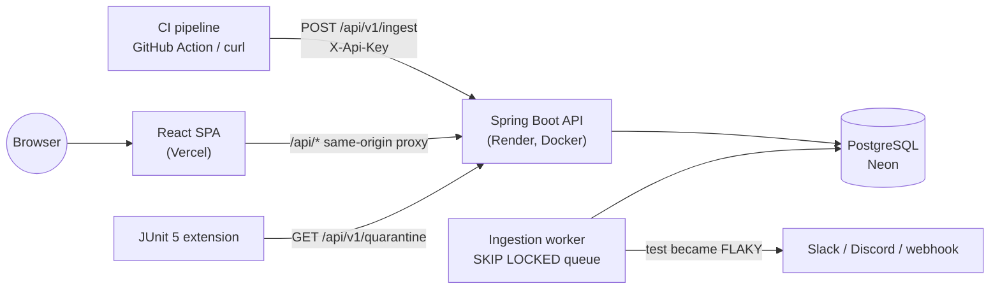

# FlakyHunter

**FlakyHunter finds flaky tests.** Send it the test results of every CI run (JUnit XML or Playwright JSON).
It tracks each test across runs, scores how *flaky* it is, tells flaky tests apart from genuinely **broken**
ones, groups failures by root cause, and lets teams **quarantine** bad tests so they stop blocking builds.

**▶ Live demo (no account needed): <https://flakyhunter.vercel.app/p/demo>** — a fictional shop with 300 tests
and 60 days of CI runs. API docs: <https://flakyhunter.vercel.app/api/docs>.
*(The free backend sleeps when idle: the first visit can take about a minute.)*

> During my QA internship I saw flaky tests waste hours of developer time, so I built a service that ingests CI
> test reports, detects flakiness statistically, and lets teams quarantine flaky tests — Java/Spring Boot with a
> React dashboard.

## What it does

| | |
| --- | --- |
| **Ingest** | `POST /api/v1/ingest` with an API key; JUnit XML (Maven Surefire incl. reruns, Gradle, pytest) and Playwright JSON; format detected automatically |
| **Score** | every test gets a 0–1 flakiness score and a verdict: `NEW`, `STABLE`, `SUSPECT`, `FLAKY`, `BROKEN` |
| **Explain** | test page with a 50-run heatmap, the score broken down by signal, durations, state history |
| **Group** | failures normalised into root-cause signatures ("Timeout 3000ms…" and "Timeout 5000ms…" are one problem) |
| **Quarantine** | members quarantine a test with a reason and an expiry; CI skips it via the **JUnit 5 extension** or a Playwright `--grep-invert` pattern |
| **Alert** | Slack / Discord / signed generic webhooks when a test becomes flaky |
| **Dashboard** | pass rate and runs-per-day trends, KPIs vs the previous period, leaderboard, newly flaky this week |

## Architecture



A **modular monolith** (ADR-0001): one Spring Boot app split into modules — `auth`, `project`, `ingestion`,
`parsing`, `analysis`, `catalog`, `dashboard`, `quarantine`, `notification`, `demo` — whose boundaries are checked
by ArchUnit tests. Decisions are recorded in [`docs/adr/`](docs/adr); the full plan is [`docs/PLAN.md`](docs/PLAN.md).

## How the flakiness score works

For each test FlakyHunter looks at its last 30 executed runs and combines three signals (ADR-0004):

| Signal | Meaning |
| --- | --- |
| **R** — retry | failed, then passed on a re-run *in the same CI run* |
| **F** — flips | the outcome keeps alternating pass ↔ fail |
| **C** — same commit | the same commit both passed and failed |

`score = min(1, 0.45·min(1, 2R) + 0.35·min(1, 2F) + 0.20·C)`. Score ≥ 0.30 → **FLAKY**. Three straight failures
without a retry-pass → **BROKEN**: a real regression creates a fail streak with only two flips (break → fix), so it
is not mistaken for flakiness. Weights and thresholds are configuration; a "nightly" job recomputes everything.

## Hard problems solved

- **Exactly-once ingestion without a message broker** — uploads become rows in a PostgreSQL queue consumed with
  `FOR UPDATE SKIP LOCKED`; an idempotency key (`ciProvider:runId:attempt`) with `ON CONFLICT DO NOTHING` means a
  retried CI step can't create a duplicate run (tested with 10 parallel uploads → 1 run).
- **No races on per-test stats** — a per-project advisory lock and strictly ordered processing per project;
  stats are updated incrementally so dashboards never scan history.
- **Safe parsing** — streaming StAX with DTDs/external entities disabled (XXE), zip-bomb and size limits, broken
  reports become a readable job error instead of a 500.
- **Multi-tenant security** — one `ProjectAccess` gate; non-members get 404 (slugs can't be probed); the public
  demo is readable anonymously, nothing else is. Cookie-based JWTs (HttpOnly) with rotating refresh tokens and
  reuse detection, CSRF tokens, BCrypt, rate limits per IP *and* per email, webhook URLs checked against SSRF.
- **Free-tier friendly** — daily aggregates for trends, retention jobs, "nightly" jobs that run when due because
  the free server sleeps.

## Use it in your CI

```yaml
- name: Upload test results to FlakyHunter
  if: always()
  uses: Devisri4/flakyhunter/github-action@main
  with:
    api-key: ${{ secrets.FLAKYHUNTER_API_KEY }}
```

More options (curl, PowerShell, Playwright, Surefire reruns, the JUnit 5 extension) are on each project's
**Setup** page and in [`github-action/`](github-action) and [`junit5-extension/`](junit5-extension).

## Tech stack

- **Backend:** Java 25, Spring Boot 4 (Web MVC, Security, OAuth2 resource server for JWTs, Data JPA, JDBC),
  PostgreSQL 17 on Neon, Flyway, Bucket4j, springdoc-openapi — Docker on Render
- **Frontend:** React (JavaScript) + Vite, React Router, TanStack Query, Recharts — Vercel
- **Tests:** JUnit 5, AssertJ, Testcontainers, MockMvc, ArchUnit, JaCoCo; Vitest; Playwright E2E against the live
  site — all in GitHub Actions, and FlakyHunter tracks its own test results (dogfooding)

## Repository layout

| Folder | What's inside |
| --- | --- |
| `backend/` | Spring Boot API |
| `frontend/` | React web app |
| `junit5-extension/` | `flakyhunter-junit5`, skips quarantined tests |
| `github-action/` | reusable upload action |
| `e2e/` | Playwright tests against the deployed site |
| `examples/` | sample reports that show every verdict |
| `docs/` | plan and architecture decision records |

## Run the backend locally

The backend needs a PostgreSQL database (it uses Postgres features such as `FOR UPDATE SKIP LOCKED`,
advisory locks and arrays, so H2 can't stand in). The easiest option is a free Neon **dev branch**.
Set the variables from [.env.example](.env.example) in your shell, then:

```bash
cd backend
mvn spring-boot:run
```

Tests: `mvn test` runs the unit tests anywhere; the integration tests use Testcontainers and run
automatically when Docker is available (they always run in GitHub Actions).
