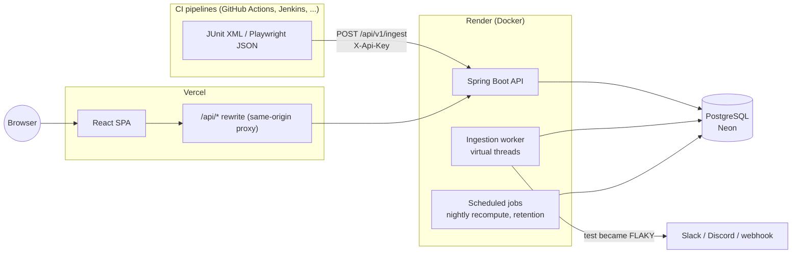
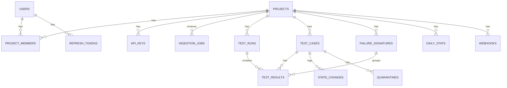
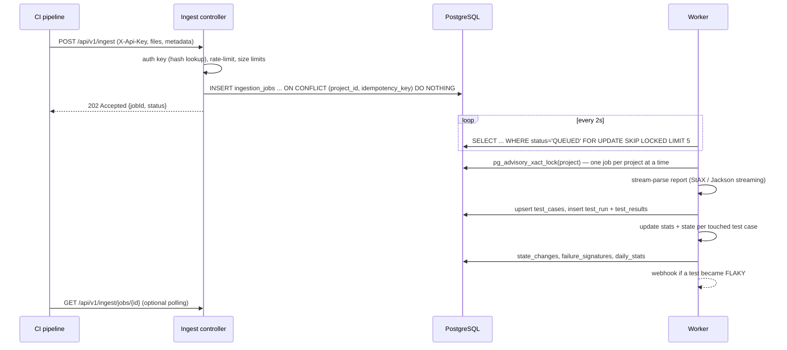

# FlakyHunter — Architecture & Implementation Plan

> **Status:** plan only, no code yet. This document is the source of truth for building FlakyHunter.
> Every phase ends with something deployed and testable. Decisions that might be questioned later are
> recorded as ADRs in `docs/adr/`.

---

## 1. Product summary

**FlakyHunter finds flaky tests.** Teams send the test results from every CI run (JUnit XML or Playwright
JSON). FlakyHunter tracks each test across runs, scores how *flaky* it is (passes and fails without a code
change), separates flaky tests from genuinely **broken** ones, groups failures by root-cause "signature", and
lets teams **quarantine** bad tests so they stop blocking builds.

**One-line pitch for interviews:**
*"During my QA internship I saw flaky tests waste hours of developer time, so I built a service that ingests
CI test reports, detects flakiness statistically, and lets teams quarantine flaky tests — written in Java/Spring
Boot with a React dashboard."*

### 1.1 Users and roles

| Role | Can do |
| --- | --- |
| **Visitor** | Landing page; read-only public demo project (no sign-up) |
| **Project viewer** | See dashboards, tests, runs, signatures of projects they belong to |
| **Project member** | + quarantine / un-quarantine tests, add notes |
| **Project owner** | + manage members, API keys, webhooks, project settings, delete project |
| **CI pipeline** (API key) | Upload test reports to one project; read that project's quarantine list |

### 1.2 Scope

**MVP (must have)**
1. Sign up / log in; projects with members and roles
2. Project API keys; upload endpoint for **JUnit XML** (Maven Surefire, Gradle, pytest `--junitxml`)
3. Asynchronous ingestion with idempotency (re-uploads never duplicate a run)
4. Flakiness engine: per-test score and state (`STABLE`, `SUSPECT`, `FLAKY`, `BROKEN`, `NEW`)
5. Failure signatures (normalised error grouping)
6. Dashboard: KPIs, trends, flaky leaderboard, test explorer, test detail timeline, run list/detail
7. Quarantine workflow + public demo project with realistic generated data
8. Setup page with copy-paste snippets (curl, GitHub Actions)

**V1 (should have)**
- **Playwright JSON** support (retries per test are first-class there)
- Reusable **GitHub Action** for uploading results
- **Webhook alerts** (Slack/Discord/generic) when a test becomes flaky
- **`flakyhunter-junit5` extension** — a tiny Java library that skips quarantined tests automatically
- Dogfooding: VehicleStore's and FlakyHunter's own CI results flow into FlakyHunter

**Stretch (nice to have)**
- "Sign in with GitHub" (OAuth2)
- Live dashboard updates via Server-Sent Events
- GitHub PR comment with "this PR's failures are known-flaky"
- GraalVM native image for faster cold starts

**Out of scope:** running tests, storing artifacts/videos, billing, multi-region.

---

## 2. Architecture overview

### 2.1 Style: modular monolith

One Spring Boot application with **feature modules** whose boundaries are enforced by tests (ArchUnit).
Rationale (ADR-0001): one deployable keeps free-tier hosting simple, while module boundaries show
design discipline and leave a path to extract services later.



**Why a same-origin proxy:** the React app on Vercel rewrites `/api/*` to the Render backend. The browser
only ever talks to one domain, so auth cookies are first-party (`SameSite=Lax`), and there is no CORS setup
in production. (ADR-0003)

### 2.2 Technology choices

| Layer | Choice | Notes |
| --- | --- | --- |
| Language / runtime | **Java 25 (LTS)** | Already installed on the laptop. Virtual threads, records, pattern matching |
| Framework | **Spring Boot** (latest stable at scaffold time — 4.0.x, or 3.5.x if a dependency lags) | Web MVC, Security, Data JPA, Validation, Actuator |
| Build | **Maven** + Maven Wrapper (`mvnw`) | Same Maven version locally and in CI |
| Database | **PostgreSQL 16+** on **Neon** (free tier) | Schema via **Flyway** migrations |
| Auth | Spring Security, **JWT in httpOnly cookies** (access 15 min + rotating refresh 7 days) | BCrypt passwords; CSRF token cookie for SPA |
| API docs | **springdoc-openapi** → Swagger UI at `/api/docs` | Recruiters can click through the API |
| Rate limiting | **Bucket4j** (in-memory) | Ingest endpoint per API key |
| Frontend | **React + TypeScript + Vite**, Tailwind CSS, React Router | |
| Data fetching | **TanStack Query** | Caching, pagination, background refresh |
| Charts | **Recharts** | Trends, duration charts, outcome heatmap |
| Forms | react-hook-form + zod | |
| Backend tests | JUnit 5, AssertJ, Mockito, **Testcontainers** (Postgres), MockMvc, ArchUnit, JaCoCo | Testcontainers runs in CI (no Docker on the laptop) |
| Frontend tests | Vitest + React Testing Library | |
| E2E | Playwright (in GitHub Actions) | Same approach as VehicleStore |
| Hosting | Backend: **Render** free web service (Dockerfile). Frontend: **Vercel** | Verify free-tier limits at setup time |

### 2.3 Repository layout (monorepo)

```
flakyhunter/
├── backend/                     Spring Boot app (Maven)
│   ├── src/main/java/dev/flakyhunter/
│   │   ├── FlakyHunterApplication.java
│   │   ├── common/              errors (ProblemDetail), pagination, time, ids
│   │   ├── auth/                users, login, JWT cookies, refresh tokens
│   │   ├── project/             projects, members, roles, API keys
│   │   ├── ingestion/           upload endpoint, job queue, worker
│   │   ├── parsing/             JUnit XML (StAX) + Playwright JSON parsers
│   │   ├── analysis/            flakiness scoring, states, failure signatures
│   │   ├── catalog/             test cases, runs, results (read models)
│   │   ├── dashboard/           summary, trends, leaderboard queries
│   │   ├── quarantine/          quarantine workflow + API-key read endpoint
│   │   ├── notification/        webhooks
│   │   └── demo/                demo data generator (profile "demo")
│   ├── src/main/resources/
│   │   ├── application.yml, application-dev.yml, application-prod.yml
│   │   └── db/migration/        V1__init.sql, V2__..., ...
│   ├── src/test/...             unit, integration, architecture tests
│   │   └── resources/reports/   sample JUnit XML / Playwright JSON fixtures
│   └── Dockerfile
├── frontend/                    React + TS + Vite
│   └── src/{api,features,components,routes,lib}
├── junit5-extension/            (V1) flakyhunter-junit5 library
├── e2e/                         Playwright tests against the deployed app
├── examples/                    sample reports + GitHub Action usage
├── docs/
│   ├── PLAN.md                  this file
│   ├── adr/                     architecture decision records
│   └── screenshots/
└── .github/workflows/           backend.yml, frontend.yml, e2e.yml, keep-alive.yml
```

---

## 3. Domain model and database

### 3.1 Concepts

- **Project** — one codebase being tested. Has a default branch (e.g. `main`).
- **Test run** — one CI execution's report for a project (commit SHA, branch, build URL, totals).
- **Test case** — a unique test, identified by a stable **fingerprint** = SHA-256 of
  `suite + "::" + name` (normalised: trimmed, parameter values kept, file path ignored so moves don't reset history).
- **Test result** — the outcome of one test case in one run, including retry attempts.
- **Failure signature** — normalised error + top stack frames, so "the same failure" groups together.
- **State** — the engine's verdict per test case: `NEW`, `STABLE`, `SUSPECT`, `FLAKY`, `BROKEN`
  (+ an independent **quarantined** flag).

### 3.2 Entity-relationship diagram



### 3.3 Tables (V1__init.sql outline)

| Table | Key columns | Constraints / indexes |
| --- | --- | --- |
| `users` | `id uuid`, `email citext`, `password_hash`, `display_name`, `created_at` | `unique(email)` |
| `refresh_tokens` | `id`, `user_id`, `token_hash`, `expires_at`, `revoked_at`, `replaced_by` | rotation + reuse detection |
| `projects` | `id uuid`, `slug`, `name`, `default_branch`, `is_public_demo`, `created_at` | `unique(slug)` |
| `project_members` | `project_id`, `user_id`, `role` (`OWNER`/`MEMBER`/`VIEWER`) | `pk(project_id, user_id)` |
| `api_keys` | `id`, `project_id`, `name`, `prefix` (first 8 chars shown in UI), `key_hash`, `last_used_at`, `revoked_at` | `unique(key_hash)`; only the hash is stored |
| `ingestion_jobs` | `id`, `project_id`, `idempotency_key`, `format`, `payload bytea` (gzip), `metadata jsonb`, `status`, `attempts`, `locked_at`, `error`, `run_id` | `unique(project_id, idempotency_key)`; partial index on `status='QUEUED'` |
| `test_runs` | `id bigint`, `project_id`, `commit_sha`, `branch`, `ci_provider`, `build_url`, `triggered_at`, `duration_ms`, `total`, `passed`, `failed`, `skipped`, `flaky` | `index(project_id, triggered_at desc)` |
| `test_cases` | `id bigint`, `project_id`, `fingerprint`, `suite`, `name`, `file`, `first_seen`, `last_seen`, **stats columns** (below) | `unique(project_id, fingerprint)`; `index(project_id, state, score desc)` |
| `test_results` | `id bigint`, `run_id`, `test_case_id`, `outcome`, `attempts`, `failed_attempts`, `duration_ms`, `signature_id`, `message` (≤2 KB), `stack` (≤8 KB) | `index(test_case_id, run_id desc)`; `unique(run_id, test_case_id)` |
| `failure_signatures` | `id`, `project_id`, `hash`, `exception_type`, `normalized_message`, `sample_stack`, `first_seen`, `last_seen`, `occurrences` | `unique(project_id, hash)` |
| `state_changes` | `id`, `test_case_id`, `from_state`, `to_state`, `run_id`, `changed_at` | timeline + "newly flaky" alerts |
| `quarantines` | `id`, `test_case_id`, `reason`, `created_by`, `created_at`, `expires_at`, `lifted_at`, `lifted_by` | at most one active per test (partial unique index) |
| `daily_stats` | `project_id`, `day`, `runs`, `tests_executed`, `passed`, `failed`, `flaky_tests`, `avg_run_duration_ms` | `pk(project_id, day)` — cheap trend charts |
| `webhooks` | `id`, `project_id`, `kind`, `url`, `secret`, `enabled`, `last_status` | |

**Stats columns on `test_cases`** (kept up to date incrementally, so the dashboard never scans history):
`window_outcomes varchar(30)` (one char per recent run: `P` pass, `F` fail, `R` passed-after-retry,
`S` skipped — newest last), `window_commits` (parallel list of short SHAs as `text[]`), `runs_in_window`,
`flip_count`, `retry_pass_count`, `fail_streak`, `score numeric(4,3)`, `state`, `stats_updated_at`.

**Retention (free tier is small, ADR-0005):** `message/stack` cleared after 30 days, `test_results` older than
180 days deleted nightly, `daily_stats` kept forever. Payloads in `ingestion_jobs` deleted once processed.

---

## 4. Key flows

### 4.1 Ingestion (asynchronous, idempotent)



Design points worth explaining in interviews:
- **Idempotency key** = CI provider + run ID + attempt (sent by the uploader; generated if absent). A CI
  retry of the upload step can't create a duplicate run.
- **`FOR UPDATE SKIP LOCKED`** turns a plain table into a safe job queue without Redis/Kafka.
- **Per-project advisory lock** prevents two concurrent runs of the same project from racing on the same
  test-case stats rows.
- **Stuck job recovery:** jobs `PROCESSING` with `locked_at` older than 5 minutes return to `QUEUED`;
  after 3 attempts they become `FAILED` with the error stored and visible in the UI.
- **Virtual threads** (`spring.threads.virtual.enabled=true`) for request handling and the worker.

### 4.2 Parsing

- **JUnit XML** via **StAX** (streaming) — handles `<testsuites>`/`<testsuite>`/`<testcase>` with
  `<failure>`, `<error>`, `<skipped>`, Surefire `<flakyFailure>`/`<rerunFailure>` (retry info), and
  `<system-out>` ignored. Secure parser: DTDs and external entities **disabled** (prevents XXE).
- **Playwright JSON** via Jackson streaming — walks `suites → specs → tests → results[]`; each `results[]`
  entry is one attempt, so retries are exact.
- Limits: 10 MB per upload, 20 files, 50 000 test cases per run, gzip accepted; zip-bomb guard on decompressed
  size. Malformed reports produce a clear `FAILED` job error, never a 500.
- Parsers output a format-neutral model: `ParsedRun(List<ParsedTest>)` → the analysis module never knows
  which format it came from.

### 4.3 Flakiness engine (ADR-0004)

For each test case, look at the **window** = its last 30 runs where it actually executed (skips ignored).
Needs at least 5 runs; until then the state is `NEW`.

Signals (each 0–1):

| Signal | Meaning | Calculation |
| --- | --- | --- |
| **R** — retry flakiness | Failed at least once, then passed on retry, *in the same run* | `retry_pass_count / runs_in_window` |
| **F** — flip rate | Outcome keeps alternating pass↔fail | `flip_count / (runs_in_window − 1)` |
| **C** — same-commit inconsistency | Same commit SHA produced both pass and fail | `inconsistent_commits / commits_with_2+_runs` |

`score = min(1, 0.45·min(1, 2R) + 0.35·min(1, 2F) + 0.20·C)`

| State | Rule (evaluated in order) |
| --- | --- |
| `NEW` | fewer than 5 runs in window |
| `BROKEN` | failed in each of the last 3 runs **and** no retry-pass among them (a real bug, not flakiness) |
| `FLAKY` | `score ≥ 0.30` |
| `SUSPECT` | `score ≥ 0.10`, or any retry-pass in the last 10 runs |
| `STABLE` | otherwise |

Why it works: a genuine regression creates a short fail streak with only **two** flips (break → fix), which
keeps `F` low and is reported as `BROKEN`; a flaky test alternates often and/or passes on retry. Weights and
thresholds live in configuration (`flakyhunter.scoring.*`) and are unit-tested with table-driven cases
(`@ParameterizedTest` over outcome strings like `"PPFPPRPFPP"`).

**Incremental update:** on each new result, append to `window_outcomes`, drop the oldest beyond 30, update
counters, recompute score/state, and write a `state_changes` row only when the state changes.
A **nightly job** recomputes all stats from `test_results` as a safety net (and to apply config changes).

### 4.4 Failure signatures

1. Take the exception type + first line of the message + the top 3 stack frames **from the project's own
   packages** (frames from frameworks/JDK skipped).
2. Normalise: numbers → `<n>`, hex/UUIDs → `<id>`, quoted strings → `<str>`, durations → `<dur>`,
   line numbers removed.
3. SHA-256 → `failure_signatures.hash`. Same root cause across many tests/runs ⇒ one signature with a count.

Example: `TimeoutError: locator.click: Timeout 5000ms exceeded waiting for "#submit-42"` and
`... Timeout 3000ms ... "#submit-7"` both become `TimeoutError: locator.click: Timeout <dur> exceeded waiting for <str>`.

### 4.5 Quarantine

- Members quarantine a test with a **reason** and optional **expiry** (default 14 days, so quarantine can't
  become a graveyard). Expired quarantines lift automatically (nightly job) and are logged.
- FlakyHunter cannot skip tests in someone's CI by itself, so it **publishes** the list:
  `GET /api/v1/quarantine` (API key) → `[{fingerprint, suite, name}]`.
- **V1: `flakyhunter-junit5`** — a ~150-line JUnit 5 `ExecutionCondition` extension that fetches the list once
  per test run and disables quarantined tests with a clear reason. A great "I published a Java library" talking point.
- Playwright users get a generated `--grep-invert` pattern on the Setup page.

---

## 5. API design

REST + JSON, errors as **RFC 9457 `ProblemDetail`**, pagination via `page`, `size`, `sort`.
Browser endpoints use cookie auth; CI endpoints (`/api/v1/...`) use `X-Api-Key`.

| Method & path | Auth | Purpose |
| --- | --- | --- |
| `POST /api/auth/signup`, `POST /api/auth/login` | — | Create account / log in (sets cookies) |
| `POST /api/auth/refresh`, `POST /api/auth/logout`, `GET /api/auth/me` | cookie | Session lifecycle |
| `GET /api/projects`, `POST /api/projects` | user | List my projects / create |
| `GET/PATCH/DELETE /api/projects/{slug}` | viewer / owner | Project details / settings |
| `GET/POST/PATCH/DELETE /api/projects/{slug}/members` | owner | Members and roles |
| `GET/POST/DELETE /api/projects/{slug}/api-keys` | owner | Keys (full key shown **once** on create) |
| `GET /api/projects/{slug}/summary?days=30` | viewer | KPIs: pass rate, flaky count, runs/day, avg duration |
| `GET /api/projects/{slug}/trends?days=30` | viewer | Daily series from `daily_stats` |
| `GET /api/projects/{slug}/tests?state=&q=&quarantined=&sort=score,desc&page=` | viewer | Test explorer |
| `GET /api/projects/{slug}/tests/{id}` | viewer | Test detail: stats, state history, signatures |
| `GET /api/projects/{slug}/tests/{id}/results?page=` | viewer | Outcome timeline + durations |
| `GET /api/projects/{slug}/runs?branch=&page=`, `GET .../runs/{id}` | viewer | Runs list / run detail |
| `GET /api/projects/{slug}/signatures?page=` | viewer | Failure signatures by frequency |
| `POST/DELETE /api/projects/{slug}/tests/{id}/quarantine` | member | Quarantine / lift |
| `GET/POST/PATCH/DELETE /api/projects/{slug}/webhooks` | owner | Alerts |
| `POST /api/v1/ingest` | API key | Upload report(s) → `202 {jobId}` |
| `GET /api/v1/ingest/jobs/{id}` | API key | Job status |
| `GET /api/v1/quarantine` | API key | Quarantined tests for CI tools |
| `GET /actuator/health` | — | Health + keep-alive target |

**Authorization rule:** every `/api/projects/{slug}/**` request resolves the caller's role in that project
in one place (a `ProjectAccess` component used via `@PreAuthorize`). Non-members get **404, not 403**, so
project slugs can't be probed. Integration tests cover "user A cannot read project B" for every endpoint group.

---

## 6. Security checklist

- Passwords: BCrypt (strength 12); login rate-limited; generic "invalid email or password" message.
- Tokens: access JWT 15 min + refresh 7 days in `HttpOnly; Secure; SameSite=Lax; Path=/api` cookies;
  refresh tokens stored **hashed**, rotated on each use, reuse ⇒ revoke the whole family.
- CSRF: Spring Security `CookieCsrfTokenRepository` + header from the SPA for state-changing requests.
- API keys: 32 random bytes, `fh_` prefix, SHA-256 hash stored, shown once, revocable, `last_used_at` tracked.
- XML: XXE disabled; size and count limits; uploads never written to disk.
- Multi-tenancy: every query filtered by `project_id` from the authorised context (never from client input alone).
- Secrets only in environment variables (Render/Vercel); `.env.example` documents names; nothing in git.
- Webhook calls: timeout 5 s, HTTPS only, HMAC signature header with the webhook secret.
- Dependency scanning: GitHub Dependabot enabled.

---

## 7. Frontend design

### 7.1 Pages

| Route | Page | Highlights |
| --- | --- | --- |
| `/` | Landing | What it does, screenshot, "View live demo" (no login) |
| `/login`, `/signup` | Auth | Demo button like VehicleStore |
| `/projects` | Project list | Health badge per project, create project |
| `/p/:slug` | **Dashboard** | KPI cards, pass-rate & flaky-count trend, **top flaky leaderboard**, newly flaky this week, recent runs |
| `/p/:slug/tests` | Test explorer | Search, filter by state/quarantined, sort by score/duration/last seen; state badges |
| `/p/:slug/tests/:id` | **Test detail** | Outcome **heatmap** of last 50 runs (colour per P/F/R/S), score breakdown (R/F/C), duration chart, state history, signatures, quarantine button |
| `/p/:slug/runs`, `/p/:slug/runs/:id` | Runs | Totals, duration, commit/branch links, failed & flaky tests in the run |
| `/p/:slug/signatures` | Signatures | Most common failure causes and affected tests |
| `/p/:slug/settings` | Settings | API keys, members, webhooks, danger zone |
| `/p/:slug/setup` | Setup guide | Copy-paste curl, GitHub Action, Maven Surefire rerun config, JUnit 5 extension |

### 7.2 Structure and conventions

- `src/api/` — typed fetch client (sends CSRF header, handles 401 → refresh → retry once) + TanStack Query hooks.
- `src/features/<feature>/` — pages and feature components; `src/components/ui/` — shared kit (buttons,
  cards, badges, tables, skeletons, empty states) in the same visual language as VehicleStore.
- Loading skeletons, empty states with guidance ("No runs yet — see Setup"), error boundaries, toasts.
- Accessibility: keyboard-navigable tables, heatmap cells with `aria-label`s, colour + icon for states
  (not colour alone).

---

## 8. Testing strategy

| Level | Tooling | What | Target |
| --- | --- | --- | --- |
| Unit | JUnit 5, AssertJ | Parsers (fixtures for Surefire, Gradle, pytest, Playwright, malformed), scoring table, signature normaliser, fingerprinting | Core logic ≥ 90 % line coverage |
| Integration | `@SpringBootTest` + **Testcontainers** Postgres + MockMvc | Ingest → job → run/results/stats; idempotency; auth flows; cross-project access denied; ProblemDetail errors | Every endpoint group |
| Concurrency | JUnit + executor | Same idempotency key uploaded 10× in parallel ⇒ 1 run; two runs of one project processed concurrently ⇒ consistent stats | Must pass in CI |
| Architecture | **ArchUnit** | Modules only talk through public APIs; controllers never touch repositories directly | Enforced |
| Frontend | Vitest + RTL | API client refresh logic, heatmap rendering, forms validation | Key components |
| E2E | Playwright | Demo login, dashboard renders, test detail heatmap, quarantine round-trip on a sandbox project | After every deploy |
| Dogfooding | — | FlakyHunter's own JUnit + Playwright results are uploaded to FlakyHunter | Live in demo |

Testcontainers needs Docker, which the laptop doesn't have: those tests are tagged `@Testcontainers(disabledWithoutDocker = true)`
so `mvn test` still runs unit tests locally, and **GitHub Actions runs everything**.

---

## 9. DevOps

### 9.1 Environments

| Env | Backend | Database | Frontend |
| --- | --- | --- | --- |
| Local | `./mvnw spring-boot:run -Dspring-boot.run.profiles=dev` | Neon **dev branch** (see risk R2) | StackBlitz or Vercel preview, pointing at the dev API |
| CI | Testcontainers Postgres | ephemeral | `npm ci && npm run build` |
| Prod | Render (Docker) | Neon main branch | Vercel, `/api/*` rewritten to Render |

### 9.2 Workflows (`.github/workflows/`)

- `backend.yml` — `./mvnw -B verify` (unit + Testcontainers + ArchUnit + JaCoCo), upload JUnit XML **to FlakyHunter**.
- `frontend.yml` — lint, typecheck, Vitest, build.
- `e2e.yml` — wait until Render reports the pushed commit on `/actuator/info`, then run Playwright
  (same pattern as VehicleStore); upload results to FlakyHunter; keep videos as artifacts.
- `keep-alive.yml` — ping `/actuator/health` on a schedule so the free backend isn't asleep for demo visitors
  (respect free-tier monthly hour limits).

### 9.3 Deployment

- **Dockerfile:** multi-stage — `eclipse-temurin:25-jdk` + Maven wrapper build → `eclipse-temurin:25-jre`
  runtime, non-root user, `-XX:MaxRAMPercentage=75`, Spring Boot layered jar for faster rebuilds.
- **Flyway** runs migrations on startup; migrations are append-only and reviewed in PRs.
- **Config via env vars:** `DATABASE_URL`, `DATABASE_USER`, `DATABASE_PASSWORD`, `JWT_SECRET`,
  `APP_BASE_URL`, `DEMO_MODE`.
- Cold starts: Render's free tier sleeps when idle; the landing page shows a friendly "waking up the demo…" state
  while `/actuator/health` responds.

---

## 10. Implementation phases

Each phase ends **deployed, tested and demoable**. Sizes: S ≈ 2–3 evenings, M ≈ 1 week part-time, L ≈ 2 weeks part-time.

### Phase 0 — Environment and skeleton (S) ✅ done 2026-10-30
- [x] Laptop checks: `java -version` (25), `mvn -v`, Maven Central reachable (download one dependency),
      Postgres port 5432 to Neon reachable (risk R2), Vercel + Render accounts
- [x] Scaffold backend at start.spring.io (Web, Security, JPA, Validation, Actuator, Flyway, PostgreSQL, Testcontainers);
      scaffold frontend (Vite React TS) via StackBlitz
- [x] Monorepo on GitHub, ADR-0001…0005 written, `.env.example`, README skeleton
- [x] CI: backend + frontend workflows green
- [x] Deploy "hello" API to Render and SPA to Vercel with the `/api` rewrite working end-to-end
- **Done when:** the deployed SPA shows the API's `/actuator/health` status through the proxy.

> **Phase 0 notes:** Spring Boot **4.1.2**. Neon and Render both in **US East (Ohio)**. Actuator lives at
> **`/api/actuator/*`** (so the single `/api/*` Vercel rewrite covers it; keep-alive/E2E use that path).
> Frontend files were written by hand (no Node on the laptop, StackBlitz not needed); there is no
> `package-lock.json` yet, so CI uses `npm install` until one is generated.
> Live: <https://flakyhunter.vercel.app> → <https://flakyhunter.onrender.com>.

### Phase 1 — Auth, projects, API keys (M) ✅ done 2026-10-30
- [x] V1 migration: users, refresh_tokens, projects, project_members, api_keys
- [x] Signup/login/refresh/logout/me with cookie JWTs + CSRF; ProblemDetail errors
- [x] Projects CRUD, members/roles, `ProjectAccess` + 404-for-non-members
- [x] API keys: create (shown once), list, revoke
- [x] Frontend: auth pages, project list, create project, settings → API keys
- [x] Tests: auth flow, refresh rotation/reuse, cross-project isolation
- **Done when:** a user signs up on the live site, creates a project and gets an API key.

> **Phase 1 notes:** JWTs via Spring Security's OAuth2 resource server (Nimbus, HS256, `JWT_SECRET` on Render),
> read from the `fh_access` cookie; refresh token in `fh_refresh` (Path `/api/auth`), rotated per family.
> CSRF uses Spring Security's `csrf().spa()` (`XSRF-TOKEN` cookie → `X-XSRF-TOKEN` header).
> Emails are stored lower-case with a unique `lower(email)` index instead of `citext`.
> `ProjectAccess.require(slug, role)` is called at the start of each service method rather than via `@PreAuthorize`.
> Frontend uses plain CSS for now (Tailwind / react-hook-form / zod can come with the Phase 4 UI).
> **Still open from the security checklist:** login rate limiting (add with Bucket4j in Phase 2 alongside the ingest limiter).

### Phase 2 — Ingestion and JUnit XML parsing (M)
- [ ] V2 migration: ingestion_jobs, test_runs, test_cases, test_results
- [ ] `POST /api/v1/ingest` with limits, rate limit, idempotency; job status endpoint
- [ ] Worker with `SKIP LOCKED`, advisory lock, retries, stuck-job recovery
- [ ] StAX JUnit parser + fixtures (Surefire incl. reruns, Gradle, pytest, malformed)
- [ ] Runs list/detail pages; Setup page with curl snippet
- [ ] Tests: parser fixtures, idempotency concurrency test, end-to-end ingest integration test
- **Done when:** `curl` uploads a real Surefire report and the run appears on the dashboard.

### Phase 3 — Flakiness engine and signatures (M)
- [ ] V3 migration: stats columns, state_changes, failure_signatures, daily_stats
- [ ] Incremental stats + scoring + state machine; nightly recompute + retention job
- [ ] Signature normaliser and grouping
- [ ] Table-driven scoring tests; property-style tests for the normaliser
- **Done when:** a fixture history with known flaky/broken tests produces the expected states.

### Phase 4 — Dashboard UI (L)
- [ ] Summary + trends endpoints; test explorer with filters/sorting/pagination; test detail endpoints
- [ ] Dashboard page (KPI cards, trend chart, leaderboard, newly flaky)
- [ ] Test detail page (heatmap, score breakdown, duration chart, state history, signatures)
- [ ] Signatures page; skeletons, empty states, responsive layout
- [ ] **Demo data generator** (profile `demo`): 60 days of runs for a fake "acme-shop" project with ~300 tests,
      realistic patterns (stable, flaky p≈5–20 %, broken streaks, retries, slow tests), public read-only
- **Done when:** a visitor with no account can explore a convincing demo dashboard.

### Phase 5 — Playwright support, GitHub Action, dogfooding (M)
- [ ] Playwright JSON parser (attempt-level retries)
- [ ] Composite GitHub Action `flakyhunter/upload` in `examples/` (or its own repo) with inputs: api-key, files, format
- [ ] VehicleStore's E2E workflow and FlakyHunter's own CI upload results to the live instance
- **Done when:** real VehicleStore runs appear in FlakyHunter after each push.

### Phase 6 — Quarantine, alerts, JUnit 5 extension (M)
- [ ] Quarantine with reason/expiry, auto-lift, history; `GET /api/v1/quarantine`
- [ ] Webhooks (Slack/Discord/generic) with HMAC signing and delivery status
- [ ] `junit5-extension` module: `@ExtendWith(FlakyHunterExtension.class)` / auto-registration, caches list per run,
      fails open if FlakyHunter is unreachable; published via GitHub Packages (or JitPack)
- **Done when:** quarantining a test in the UI makes it skip in a sample Maven project's next CI run.

### Phase 7 — Hardening and presentation (S–M)
- [ ] Playwright E2E suite + recordings; JaCoCo coverage badge; Swagger UI polished
- [ ] Performance pass: EXPLAIN on dashboard queries, indexes verified, N+1 checks (Hibernate statistics in tests)
- [ ] README: pitch, live demo, architecture diagram, scoring explanation, screenshots, "hard problems solved"
- [ ] Optional stretch items (GitHub OAuth, SSE live updates, PR comments, native image)

---

## 11. Risks and mitigations

| # | Risk | Mitigation |
| --- | --- | --- |
| R1 | Corporate network blocks Maven Central | Check in Phase 0; if blocked, build only in GitHub Actions/StackBlitz and use the laptop for editing |
| R2 | Corporate network blocks outbound Postgres (port 5432) | `dev` profile can fall back to an embedded H2 in PostgreSQL mode for UI work; real Postgres tests always run in CI |
| R3 | No Docker locally ⇒ no Testcontainers locally | Tag as Docker-only; CI runs them on every push |
| R4 | No Node locally ⇒ frontend can't run locally | StackBlitz for live editing (Vite 6 works there), Vercel previews for every push |
| R5 | Free tiers sleep / have small storage | Keep-alive ping, retention policy, compact stats columns, `daily_stats` aggregates |
| R6 | Scoring gives false positives/negatives | Configurable weights, nightly recompute, visible score breakdown so users can see *why* |
| R7 | Report format variations | Fixture-driven parser tests; unknown elements ignored; clear job errors instead of crashes |
| R8 | Scope creep | MVP first; V1/stretch only after Phase 4 is live |

---

## 12. Architecture decision records to write in Phase 0

- **ADR-0001** Modular monolith over microservices
- **ADR-0002** PostgreSQL-backed job queue (`SKIP LOCKED`) instead of a message broker
- **ADR-0003** Same-origin `/api` proxy on Vercel + httpOnly cookie JWTs
- **ADR-0004** Flakiness scoring model (signals, weights, states)
- **ADR-0005** Data retention and aggregation for free-tier limits

---

## 13. What this project demonstrates (resume / interview)

- **Backend depth:** async processing, idempotency, row-level locking and advisory locks, streaming parsers,
  secure XML handling, multi-tenant authorisation, cookie-based JWT with refresh rotation.
- **Data & algorithms:** an explainable statistical model, incremental aggregates, query/index design.
- **Product thinking:** solves a real developer pain point; demo-first experience; setup guide.
- **Quality engineering:** unit/integration/concurrency/architecture/E2E tests, CI on every push, the tool tests
  itself (dogfooding), and a published JUnit 5 extension.

**Draft resume bullets (fill in real numbers at the end):**
- Built **FlakyHunter**, a Spring Boot + React platform that ingests JUnit/Playwright CI reports and detects flaky
  tests with an explainable scoring model, separating flaky from genuinely broken tests.
- Designed an idempotent, PostgreSQL-backed ingestion pipeline (`FOR UPDATE SKIP LOCKED`, advisory locks,
  virtual threads) processing reports of up to *N* tests in *X* ms.
- Published a JUnit 5 extension that automatically skips quarantined tests in CI; dogfooded on my own projects.
- *N* automated tests (unit, Testcontainers integration, concurrency, ArchUnit, Playwright E2E) running in GitHub Actions.

---

## 14. How to start the coding session

Open a new chat in the `flakyhunter` folder and say:

> Read `docs/PLAN.md`. Start **Phase 0**: guide me through the laptop checks one step at a time, then scaffold
> the backend and frontend and set up CI. Don't start Phase 1 until Phase 0's "Done when" is met.
